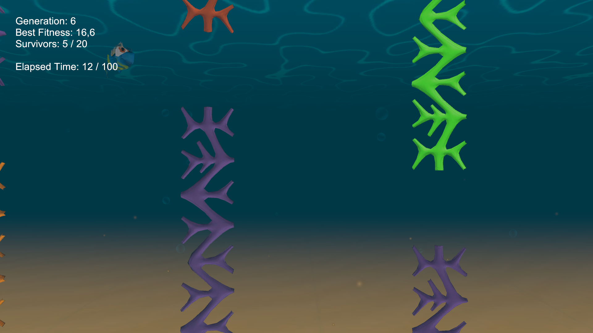
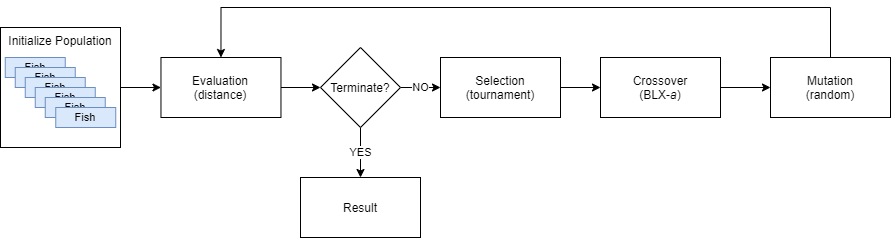
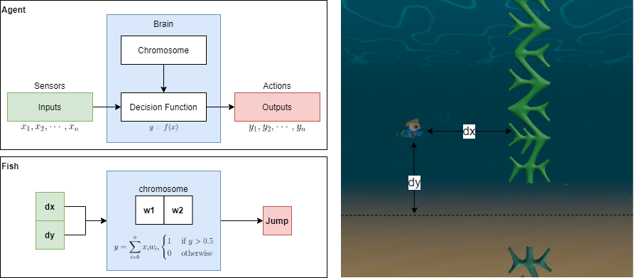
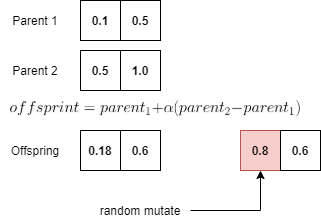

# Evolve Happy Fish

Unity Happy Fish example using a genetic algorithm to evolve a game controller.

## Getting started

- Clone the repository and add `.` to Unity Hub as an existing project.

- Use the recorded Editor version as the starting point. For an upgrade, work on a separate branch and preserve all `.meta` files and serialized asset references.

- Open a project scene in the Editor and enter Play mode. Available scene examples: [Assets/Scenes/Gameplay.unity](https://github.com/kleberandrade/evolve-happy-fish-unity/blob/master/Assets/Scenes/Gameplay.unity).

## Recorded requirements

- Recorded Unity Editor: **2019.3.10f1** in [ProjectSettings/ProjectVersion.txt](https://github.com/kleberandrade/evolve-happy-fish-unity/blob/master/ProjectSettings/ProjectVersion.txt).

## Repository map

- [Assets](https://github.com/kleberandrade/evolve-happy-fish-unity/tree/master/Assets)
- [ProjectSettings](https://github.com/kleberandrade/evolve-happy-fish-unity/tree/master/ProjectSettings)
- [Packages](https://github.com/kleberandrade/evolve-happy-fish-unity/tree/master/Packages)

## Validation status

This update documents the tracked source and project metadata. It does not certify a successful build, device test or compatibility with a current toolchain. Follow any project-specific validation instructions in the original material.

## License and attribution

No standalone repository-wide license file was identified in this review. Preserve the original credits and any component-specific licenses; this documentation update grants no additional rights.

---

## Original project material

# Genetic Algorithm - Happy Fish

Example of application of genetic algorithm for evolution flappy bird controller. Project developed in the discipline of Artificial Intelligence applied to the Digital Games - Fatec Americana

## Happy Fish (Flappy Bird based game)

Happy Fish is a casual game where you control a fish and have to guide him through the obstacles. Tap the screen to make the fish swim, in order to dodge all these obstacles.

  

Happy Fish game developed at Unity 2019.3.10

-   Mobile game: [https://play.google.com/store/apps/details?id=com.kleberandrade.happyfish](https://play.google.com/store/apps/details?id=com.kleberandrade.happyfish)

## Genetic Algorithm (GA)

  

### Chromosome

  

### Fitness Function

Fitness Function (also known as the Evaluation Function) evaluates how close a given solution is to the optimum solution of the desired problem.

-   We use the lifetime of the fish

### Elitism

A practical variant of the general process of constructing a new population is to allow the best organism(s) from the current generation to carry over to the next, unaltered. This strategy is known as elitist selection and guarantees that the solution quality obtained by the GA will not decrease from one generation to the next.

### Tournament Selection

Tournament Selection is a Selection Strategy used for selecting the fittest candidates from the current generation in a Genetic Algorithm. These selected candidates are then passed on to the next generation. In a K-way tournament selection, we select k-individuals and run a tournament among them. Only the fittest candidate amongst those selected candidates is chosen and is passed on to the next generation. In this way many such tournaments take place and we have our final selection of candidates who move on to the next generation. It also has a parameter called the selection pressure which is a probabilistic measure of a candidate’s likelihood of participation in a tournament. If the tournament size is larger, weak candidates have a smaller chance of getting selected as it has to compete with a stronger candidate. The selection pressure parameter determines the rate of convergence of the GA. More the selection pressure more will be the Convergence rate. GAs are able to identify optimal or near-optimal solutions over a wide range of selection pressures. Tournament Selection also works for negative fitness values.

1.  Select k individuals from the population and perform a tournament amongst them
2.  Select the best individual from the k individuals
3.  Repeat process 1 and 2 until you have the desired amount of population

### Blend Crossover and Random Mutation

In a uniform crossover, we don’t divide the chromosome into segments, rather we treat each gene separately. In this, we essentially flip a coin for each chromosome to decide whether or not it’ll be included in the off-spring. We can also bias the coin to one parent, to have more genetic material in the child from that parent.

Random mutation is an extension of the bit flip for the integer representation. In this, a random value from the set of permissible values is assigned to a randomly chosen gene.

  

## Experiments and Results

Initial setup of the experiment

| Variable         	              | Value |
|------------------	              |:-----:|
| Population size  	              |  20   |
| Elitism          	              |  10%   |
| Blend Crossover    	          |  0,2  |
| Mutation rate    	              |   2%  |
| Tournament size  	              |   2 indivi  |
| Trial time      	              |   100 seconds |

Video: [https://www.youtube.com/watch?v=bmvs9ugStgg](https://www.youtube.com/watch?v=bmvs9ugStgg)

## Acknowledgment

Thanks to Professor Marcio Crocomo for the ideas of the evolution strategy

## Licença

    Copyright 2020 Kleber de Oliveira Andrade
    
    Permission is hereby granted, free of charge, to any person obtaining a copy
    of this software and associated documentation files (the "Software"), to deal
    in the Software without restriction, including without limitation the rights
    to use, copy, modify, merge, publish, distribute, sublicense, and/or sell
    copies of the Software, and to permit persons to whom the Software is
    furnished to do so, subject to the following conditions:
    
    The above copyright notice and this permission notice shall be included in all
    copies or substantial portions of the Software.
    
    THE SOFTWARE IS PROVIDED "AS IS", WITHOUT WARRANTY OF ANY KIND, EXPRESS OR
    IMPLIED, INCLUDING BUT NOT LIMITED TO THE WARRANTIES OF MERCHANTABILITY,
    FITNESS FOR A PARTICULAR PURPOSE AND NONINFRINGEMENT. IN NO EVENT SHALL THE
    AUTHORS OR COPYRIGHT HOLDERS BE LIABLE FOR ANY CLAIM, DAMAGES OR OTHER
    LIABILITY, WHETHER IN AN ACTION OF CONTRACT, TORT OR OTHERWISE, ARISING FROM,
    OUT OF OR IN CONNECTION WITH THE SOFTWARE OR THE USE OR OTHER DEALINGS IN THE
    SOFTWARE.
